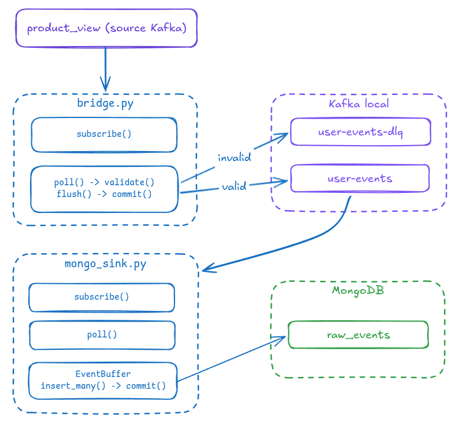
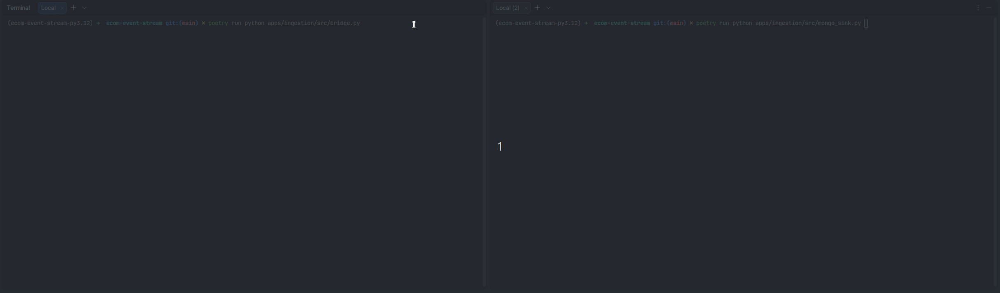
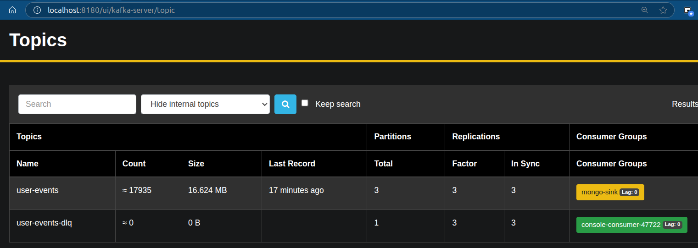
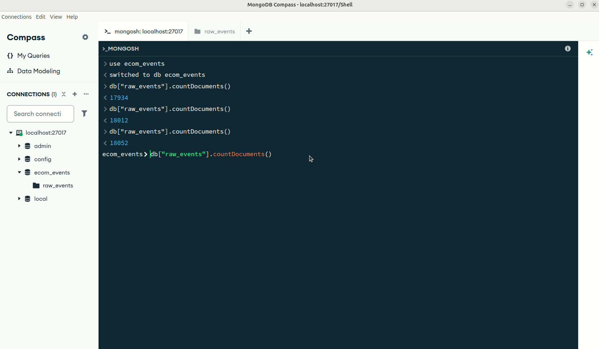

# Kafka Ingestion

Pipeline: external source Kafka (`product_view`) → validate → local Kafka (`user-events` / `user-events-dlq`) → MongoDB (`raw_events`).

## Data flow



---

## Results

**Live run**:

- Bridge consumes events from the source cluster
- Mongo sink consumes events from the local cluster & flows into MongoDB



### Verifying the data

#### AKHQ - browse Kafka

AKHQ UI: [http://localhost:8180](http://localhost:8180).
Use it to inspect messages on `user-events` / `user-events-dlq`, and check consumer group `mongo-sink` (offsets, lag).



#### MongoDB - `raw_events`

- Credentials: `.env` (`MONGO_USER` / `MONGO_PASSWORD`).



---

## How to run the program

`.env` must be filled in (source credentials + self-hosted sink/MongoDB credentials).

### Install

**1.** Start infrastructure (Kafka cluster + MongoDB). Run from the repo root, so `.env` (`CLUSTER_ID`, `MONGO_INITDB_ROOT_*`, AKHQ secrets) is picked up via `--env-file`:

```bash
make up
```

**2.** Create Kafka topics with correct partition counts. Must run before any producer/consumer triggers auto-create, otherwise `user-events-dlq` would get 3 partitions instead of 1:

```bash
make topics
```

**3.** Install deps & run unit tests:

```bash
poetry install
make test
```

Other useful targets: `make ps` (container status), `make logs` (tail logs), `make down` (stop infrastructure).

### Run ingestion (2 terminals)

```bash
# product_view -> user-events / dlq
poetry run python apps/ingestion/src/bridge.py
```

```Shell
# user-events -> MongoDB
poetry run python apps/ingestion/src/mongo_sink.py
```

`Ctrl+C` (or SIGTERM) stops either process gracefully: it finishes the batch in hand, commits its offsets, and leaves the consumer group at once instead of after the session timeout. See [Delivery guarantee](#delivery-guarantee).

---

## Delivery guarantee

Both processes are **at-least-once**: a Kafka offset is committed only after the events behind it have reached the next stage. A commit covers the last message of every partition in the batch, since committing one message only advances its own partition.

| | `bridge.py` (source → local Kafka) | `mongo_sink.py` (local Kafka → MongoDB) |
| --- | --- | --- |
| **Batch** | `BRIDGE_BATCH_SIZE` messages or `BRIDGE_FLUSH_INTERVAL_SECONDS` since the oldest pending one | `BATCH_SIZE` documents or `FLUSH_INTERVAL_SECONDS` since the last write |
| **Commits when** | both producers are flushed with nothing left in the queue **and** no delivery callback reported an error | `insert_many(ordered=False)` succeeds, or fails on duplicate keys only |
| **On failure** | raises before the commit; the batch is re-read on restart | 3 attempts (1 s, 2 s backoff), then raises before the commit; the batch is re-read on restart |
| **On `Ctrl+C` / SIGTERM** | flushes and commits the pending batch, then closes the consumer | writes and commits the partial batch, then closes the consumer and the MongoDB client |

A replay can repeat at most the one uncommitted batch per process. Downstream:

- MongoDB rejects a replayed document that carries the source `_id` (duplicate key, `E11000`); the sink treats that as already written and commits. An event without `_id` gets a fresh `ObjectId`, so its replay is stored twice in `raw_events`.
- The warehouse writer inserts with `ON CONFLICT (event_id) DO NOTHING`, so a replay never duplicates `fact_event` (see [data-processing.md](data-processing.md)).

The graceful drain does not prevent loss (uncommitted events are re-read anyway); it avoids redoing up to one batch after every restart.
